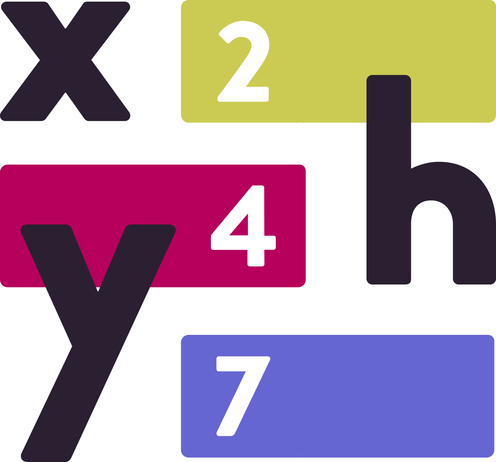
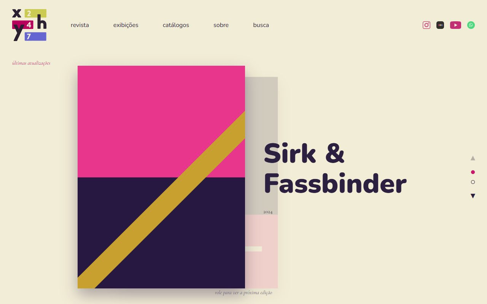
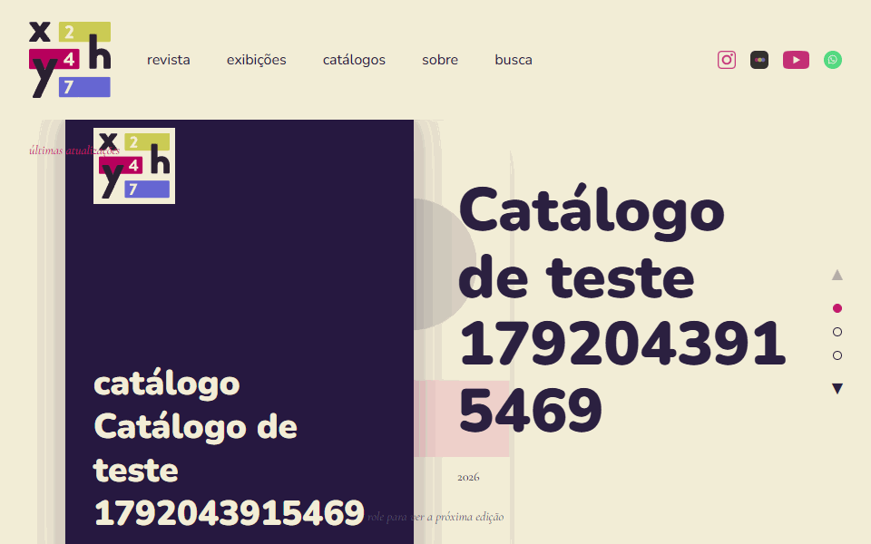
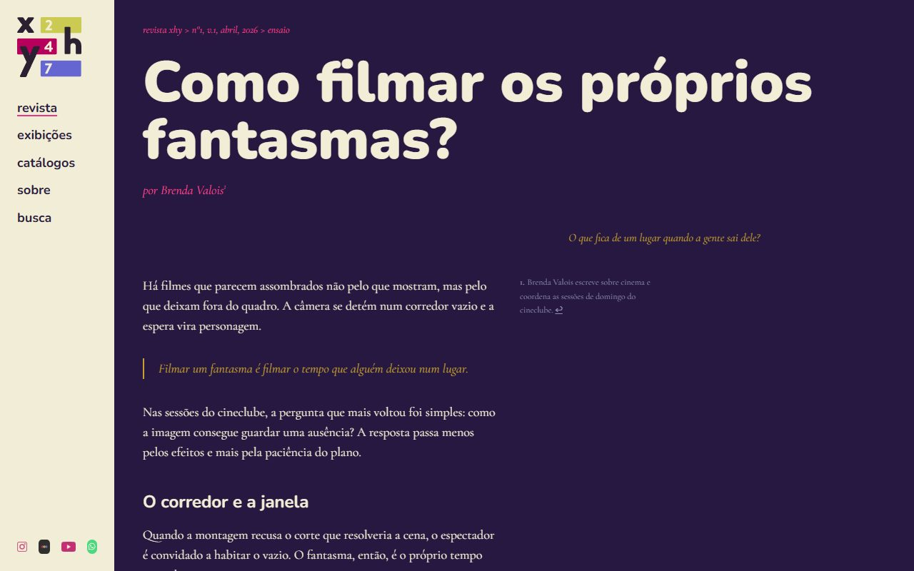
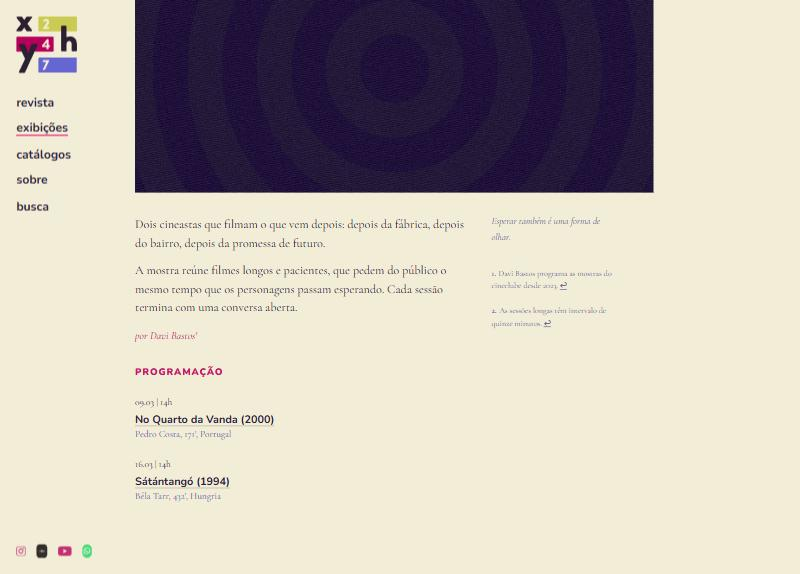
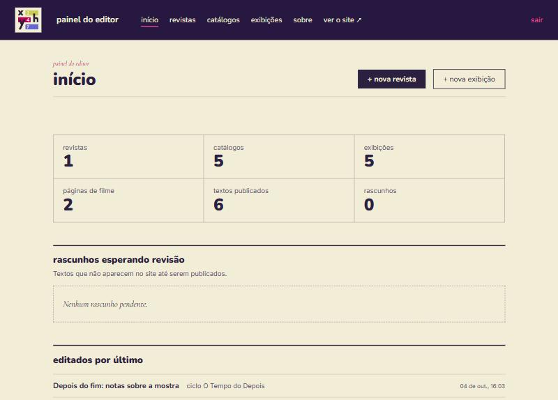
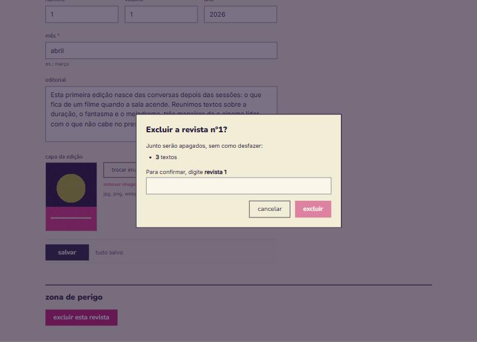
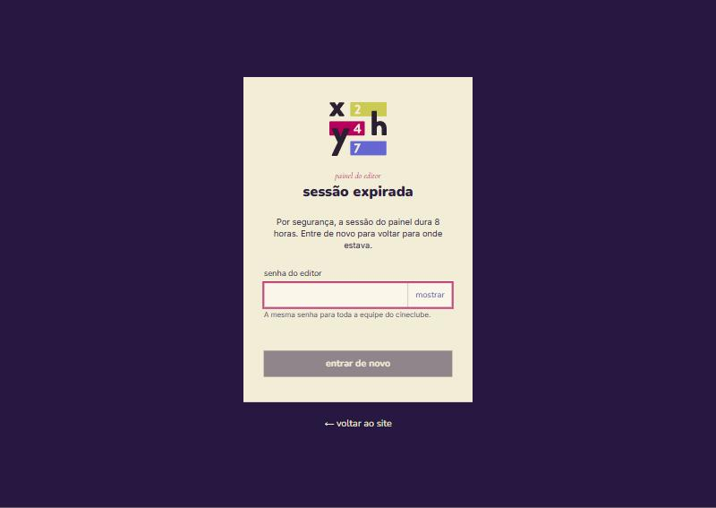
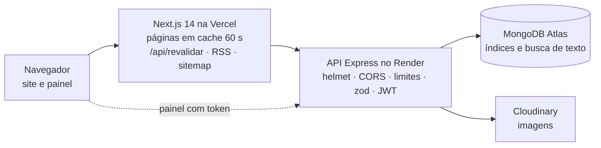
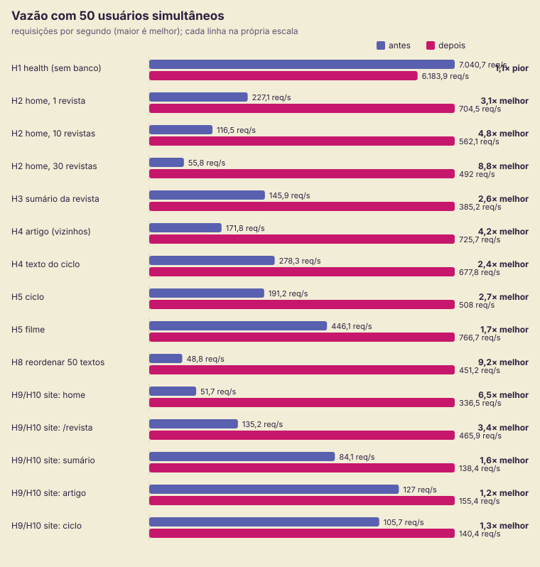

<p align="center">
  
</p>

<h1 align="center">Cineclube XHY: site e painel de publicação</h1>

<p align="center">
  Revista, catálogos e exibições de um cineclube, num site editorial com a identidade do
  material impresso e um painel para a equipe publicar sozinha.
</p>

<p align="center">
  Next.js 14 · Express · MongoDB · TypeScript nos dois lados · testes automatizados · teste de carga antes/depois
</p>

---



## Demonstração

| | Endereço |
|---|---|
| Site | <https://cineclube-xhy.vercel.app> |
| Painel do editor | <https://cineclube-xhy.vercel.app/admin/login> |
| API | <https://cineclube-xhy-api.onrender.com/api/health> |

**Conta de demonstração:** no login do painel, o botão **"Entrar no painel como editor de
demonstração"** entra com um clique, sem senha. Pode criar, editar e excluir à vontade: os
dados de exemplo e as imagens enviadas voltam ao original a cada hora, mesmo que o servidor
gratuito tenha dormido no meio (o horário do último reset fica no banco). A primeira visita
pode levar até um minuto (o servidor acorda) e o site avisa enquanto isso.

Roteiro sugerido: página inicial → uma edição da revista → um texto → busca → `como foi feito`
→ painel: início → abrir a revista → editar um texto (o rascunho fica guardado no navegador)
→ ver no site → excluir uma exibição (diálogo com contagem) → sair.




## Em 30 segundos

- **O problema:** o cineclube produzia revista, catálogos e programação, mas tudo ficava
  em PDF e imagens de rede social: sem link para citar, sem busca, ilegível no celular.
- **A solução:** um site que reproduz a diagramação do impresso (creme para navegar, roxo
  para ler, serifa nos textos) e um painel em que a equipe publica textos em blocos, com
  imagens, rascunhos e programação, sem tocar em código.
- **O que mostra de engenharia:** API organizada por recurso com validação na entrada,
  erros centralizados e segurança revisada; front com cache e revalidação sob demanda,
  estados de erro honestos e acessibilidade com contraste AA testado; testes de rota com
  banco em memória e um teste de carga com hipóteses escritas antes de medir.

| Leitura (desktop) | Leitura (celular) | Exibição com programação |
|---|---|---|
|  |  |  |

| Painel: início | Painel: exclusão em cascata | Sessão expirada |
|---|---|---|
|  |  |  |

Mais telas em [`docs/img/`](docs/img/): sumário da revista, busca, 404, editor de textos,
painel da revista, home no celular e a página [como foi feito](docs/img/14-como-foi-feito.jpg).

## Arquitetura



- **Backend** (`codigo-fonte/backend`): Express + Mongoose. Rotas públicas de leitura,
  rotas do painel uma por recurso (`routes/admin/`), validação com zod
  (`validacao/esquemas.ts`), tratador central de erros (400/404/409/413/503, nunca stack),
  limitadores, upload conferido pelos bytes. Em desenvolvimento, sem MongoDB, sobe um
  banco embutido; os testes usam um banco só em memória e são impedidos de tocar no de
  desenvolvimento.
- **Frontend** (`codigo-fonte/frontend`): Next.js App Router. Páginas de servidor com
  cache de 60 s etiquetado e revalidação sob demanda quando o editor salva; painel em
  componentes de cliente com sessão, toasts, diálogos e rascunho local. Identidade em
  tokens (`src/lib/tokens.ts`).

## Papéis

| Quem | O que faz |
|---|---|
| Leitor | Navega pela revista, catálogos e exibições, busca textos e autores, assina o RSS. Sem conta, por desenho. |
| Editor (equipe do cineclube) | Entra no `/admin` com a senha da equipe, publica e organiza o conteúdo, guarda rascunhos. |

## Testes

| Suíte | Testes | O que roda |
|---|---|---|
| API (`codigo-fonte/backend`) | 157 | node:test + supertest + MongoDB em memória |
| Site (`codigo-fonte/frontend`) | 43 | regras do front e o `middleware.ts` de verdade |
| Harness e preparo local (`carga/`, `ferramentas/`) | 16 | trava de carga e `.env` do `iniciar.bat` |
| Fluxos no navegador (`ferramentas/verificar-fluxos.mjs`) | 10 conferências | visitante e editor no Chrome headless |

```bash
cd codigo-fonte/backend && npm test     # API
cd codigo-fonte/frontend && npm test    # site: contraste AA, sessão, login, RSS, limite por IP
node --test "carga/*.test.mjs" "ferramentas/*.test.mjs"
node ferramentas/verificar-fluxos.mjs http://localhost:3000   # com o iniciar.bat rodando
```

O backend cobre rotas públicas, CRUD do painel, validação (ids, operadores do MongoDB nos
filtros, links, imagens), segurança (CORS 403, cabeçalhos, limitadores, hash da senha,
token de 8 h, upload pelos bytes, 503 com banco fora), busca/autores/RSS/sitemap,
criação concorrente com o mesmo título e a proteção do banco de desenvolvimento.

## Teste de carga

Harness em [`carga/`](carga/): k6 e MongoDB em memória na porta 27200. A API compilada roda
com o diretório de trabalho fora do repositório, para não ler `.env` real, e o site faz
`next build` apontando para a API de teste. As hipóteses foram escritas antes de medir, e
a medição foi feita antes e depois das correções, na mesma máquina que gerava a carga.

| Cenário (50 usuários simultâneos) | Antes | Depois | Hipótese |
|---|---|---|---|
| Home na API, 30 edições | 34 consultas · 56 req/s | 5 consultas · 492 req/s | H2 confirmada |
| Sumário de uma edição | 384 kB · 146 req/s | 7 kB · 385 req/s | H3 confirmada |
| Texto com anterior/próximo | 172 req/s · p95 317 ms | 726 req/s · p95 75 ms | H4 confirmada |
| Reordenar 50 textos | 49 req/s · p95 1,1 s | 451 req/s · p95 308 ms | H8 confirmada |
| 10 criações simultâneas, mesmo título | 66% com erro 500 | 0 erros | H7 confirmada |
| Consultas ao banco por página do site | 65 na home | 0 (cache) | H10 parcial |
| Vazão do site (cache) | 52 a 135 req/s | 138 a 466 req/s | H10 refutada (1,2× a 6,5×; a meta era 10×) |
| Site com a API fora do ar | 404 falso e listas vazias | conteúdo do cache | H11 confirmada |

Medido em 14 e 15/10/2026 com a trava compartilhada da oficina: uma carga por vez na máquina.
As rodadas anteriores mediram sem a trava (bug no caminho dela) e foram descartadas.



Relatório completo, com veredito de cada hipótese e limitações:
[`docs/carga/2026-10-04-resultados.md`](docs/carga/2026-10-04-resultados.md).

## Decisões

Registradas em [`docs/adr/`](docs/adr/): senha única de editor, JWT no localStorage, banco
embutido em desenvolvimento, modo demonstração, cache com revalidação e a permanência no
Next 14.2 com a superfície dos advisories fechada.

- **Cache com revalidação sob demanda** em vez de `no-store`: o visitante não espera a API
  (que dorme no plano gratuito) e o editor vê a mudança na hora.
- **Erro honesto:** API fora do ar mostra "serviço indisponível" com status 500; 404 é 404.
  Por isso as páginas de conteúdo não usam `loading.tsx` (com streaming o Next mandaria 200).
- **Senha de equipe, mas com cuidado:** comparação por hash em tempo constante, limite de
  tentativas, token curto, re-login sem perder trabalho. Contas individuais ficaram de fora
  por escolha do cineclube.
- **Token no `localStorage` + CSP** em vez de cookie: a API e o site ficam em domínios
  diferentes no plano gratuito; a CSP restringe de onde vem script. Está nas limitações.
- **Sem newsletter nem formulário de contato:** evitam guardar dados pessoais; o RSS cumpre
  o papel de acompanhar as publicações e o rodapé leva aos canais do cineclube.
- **Contraste testado:** cores de marca ficam para fundos e títulos grandes; texto pequeno
  usa variantes mais escuras/claras, conferidas por teste automatizado.

## Limitações

- Uma senha compartilhada: o painel não sabe quem alterou o quê.
- Token no navegador: um XSS bem-sucedido o levaria (a CSP reduz, não elimina).
- Datas da programação em texto livre: ainda não há "próximas sessões".
- Plano gratuito: a API dorme; o cache esconde isso do leitor, não do editor.
- Next 14.2.35 ainda tem advisories corrigidos só no 15.5+; os vetores que se aplicam estão
  fechados por configuração (otimizador de imagens desligado, sem Server Actions): [ADR 0006](docs/adr/0006-next-14-e-advisories.md).
- O teste de carga roda gerador e servidores na mesma máquina: vale para comparar versões.

## Próximos passos

- Contas individuais com papéis (editor, revisor) e histórico de alterações.
- Datas estruturadas nas sessões e agenda "próximas sessões" com calendário (.ics).
- Prévia de rascunho no próprio site (`draftMode`) e imagem de compartilhamento gerada (`next/og`).
- Cookie `httpOnly` com proxy no mesmo domínio para o token do painel.
- Migrar para Next 15.5+ / React 19: fecha os advisories hoje contornados por configuração e
  os três de DoS em RSC/App Router (GHSA-h25m-26qc-wcjf, GHSA-q4gf-8mx6-v5v3,
  GHSA-8h8q-6873-q5fj), aceitos como risco residual no [ADR 0006](docs/adr/0006-next-14-e-advisories.md).

## Rodar localmente

Pré-requisito: Node.js 22 ou superior.

No Windows, dê dois cliques em **`iniciar.bat`**. Ele confere o Node, instala o que
faltar, cria os arquivos `.env` com segredos aleatórios (sem sobrescrever os existentes),
sobe a API (http://localhost:3001) e o site (http://localhost:3000), espera a API ficar
pronta e abre o navegador. Localmente o modo demonstração vem ligado: o login do painel
tem o botão de entrar como editor, e os dados de exemplo são criados se o banco estiver vazio.
Sem MongoDB instalado, a API usa um banco embutido (baixado na primeira vez).

Ou, manualmente:

```bash
cd codigo-fonte/backend && npm install && npm run dev      # API, com banco embutido se não houver MongoDB
cd codigo-fonte/backend && npm run seed                    # dados de exemplo (pede confirmação)
cd codigo-fonte/frontend && npm install && npm run dev     # site
```

A senha do painel é a `ADMIN_PASSWORD` gerada em `codigo-fonte/backend/.env`.
Configuração completa, variáveis, tabela da API e guia de hospedagem gratuita em
[`codigo-fonte/README.md`](codigo-fonte/README.md).

## Documentação

1. [Documentação de Contexto](documentos/01-Documenta%C3%A7%C3%A3o%20de%20Contexto.md)
2. [Especificação do Projeto](documentos/02-Especifica%C3%A7%C3%A3o%20do%20Projeto.md) (requisitos com status)
3. [Metodologia](documentos/03-Metodologia.md)
4. [Projeto de Interface](documentos/04-Projeto%20de%20Interface.md)
5. [Template padrão da Aplicação](documentos/05-Template%20padr%C3%A3o%20da%20Aplica%C3%A7%C3%A3o.md)
6. [Programação de Funcionalidades](documentos/06-Programa%C3%A7%C3%A3o%20de%20Funcionalidades.md)
7. [Plano de Testes de Software](documentos/07-Plano%20de%20Testes%20de%20Software.md)
8. [Registro de Testes de Software](documentos/08-Registro%20de%20Testes%20de%20Software.md)
9. [Referências Bibliográficas](documentos/09-Refer%C3%AAncias%20Bibliogr%C3%A1ficas.md)

Os documentos 01, 04, 05 e 09 são o registro acadêmico do projeto, mantido como histórico.

## Autoria

**Jefferson Luiz Mendonça da Silva**: projeto, design de interface, desenvolvimento,
testes e documentação.
[LinkedIn](https://www.linkedin.com/in/j-luiz/) · [GitHub](https://github.com/jeffersonluizm) · [Letterboxd](https://letterboxd.com/Weinsmann/)

Feito para o Cineclube XHY:
[Instagram](https://www.instagram.com/cinexhy247/) · [YouTube](https://www.youtube.com/@XHY-247) · [Letterboxd](https://boxd.it/b9dkB).
A identidade visual (logo, cores, tipografia) é do próprio cineclube.
