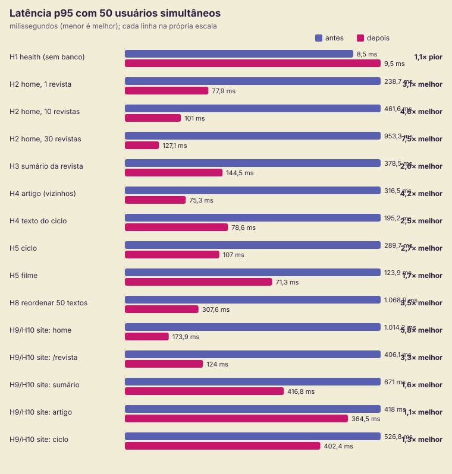

# Teste de carga: resultados antes e depois

- **Hipóteses:** registradas antes de medir em [2026-10-04-hipoteses.md](2026-10-04-hipoteses.md), commit `13083c3`.
- **Antes:** código anterior às correções, medido num worktree do commit `6332309` em 04/10/2026.
- **Depois:** commit `71a7c2c`, medido em 13/10/2026.
- **Ferramentas:** harness `carga/rodar.mjs` (k6 2.2.0 e MongoDB 8.2.6 em memória na porta 27200), relatório `carga/relatorio.mjs`.
- **Ambiente isolado:** a API compilada roda com o diretório de trabalho fora do repositório, então nenhum `.env` real é lido. O site faz `next build` apontando para a API de teste e sobe com `next start` na porta 3200.
- **Massa:** 30 revistas com 15 textos de 25 blocos cada, 10 catálogos, 20 ciclos com 25 filmes, 650 textos e 500 filmes.
- **Protocolo:** 5 s de aquecimento, depois degraus de 10, 50, 100 e 200 VUs, 15 s em cada.

> **Limitações da medição**
>
> - O gerador (k6), a API, o site e o MongoDB dividem a mesma máquina: Ryzen 5 5600 (6 núcleos, 12 threads) e 16 GB. Os números servem para **comparar as duas versões**, não para estimar capacidade de produção.
> - As duas rodadas aconteceram em dias diferentes, com outros programas abertos.
> - Na rodada "depois", a trava compartilhada de carga (`.carga-lock`) aparece recriada às 21:56 por outro processo, durante a medição. Os cenários medidos a partir daí (H5-filme, H7, H8, H6, H9) podem ter dividido CPU com outra carga. Por isso os ganhos do site (H9/H10) devem ser lidos como **mínimos**.

## Hipóteses: confirmadas e refutadas (50 VUs, salvo indicação)

| Id | Hipótese (resumo) | Medido antes → depois | Veredito |
|---|---|---|---|
| H1 | Controle sem banco: mais de 3.000 req/s, p95 abaixo de 15 ms, sem quebra até 200 VUs | 4.475 → 7.067 req/s; p95 16,7 → 11 ms; 0 erros até 200 VUs | **Confirmada** (antes o p95 ficou 1,7 ms acima da meta). O helmet não custou vazão. |
| H2 | Home faz 4 + N consultas; com 30 revistas a vazão cai abaixo de 1/4 da de 1 revista e o p95 passa de 200 ms. Depois: consultas fixas e 2× mais vazão | consultas 5/14/34 (N = 1/10/30) → 3/4/4; 30 revistas: 43 → 87 req/s, p95 1.318 → 809 ms; com 1 revista 151 → 736 req/s | **Confirmada.** Antes: 43 req/s com 30 revistas contra 151 com 1 (3,5× menos, não 4×). Depois: o número de consultas ficou fixo e a vazão dobrou; a resposta encolheu de 188 kB para 52 kB. |
| H3 | Sumário passa de 200 kB; com campos enxutos, menos da metade do tamanho e 2× a vazão | 384 kB → 6,9 kB; 105 → 257 req/s; p95 496 → 209 ms | **Confirmada** (resposta 56× menor, vazão 2,4×). |
| H4 | Vizinhos com o texto inteiro; só com título/slug/autor, 1,5× a vazão | artigo 118 → 692 req/s (p95 477 → 82 ms); texto do ciclo 189 → 684 | **Confirmada com folga** (3,6× a 5,9×). Junta `select` nos vizinhos, `lean` e índice no pai. |
| H5 | Índices em `Film.cycleId` e `Article.parentId` ajudam pouco nesse volume (cerca de 1,3×) | ciclo 135 → 439 req/s; filme 285 → 693 req/s | **Refutada para cima:** 2,4× a 3,3×. Parte vem do índice; parte do `lean`, do `select` e da resposta do ciclo, que caiu de 166 kB para 12 kB. |
| H6 | Senha certa sem limite e acima de 1.000 req/s; senha errada: 10× 401 e depois 429 | certa: 2.538 → 2.307 req/s, 0 respostas 429; errada: 10× 401 e 20× 429 nas duas versões | **Confirmada.** A comparação por hash SHA-256 e o limitador global novo custaram cerca de 9%. |
| H7 | Mesmo título concorrente gera 500 (E11000) e latência crescente; depois, zero 500 | 10 VUs: 91 de 150 criações com 500 → 0; p95 737 → 286 ms; 1 VU: p95 89 → 6,7 ms | **Confirmada.** Antes, 61% das criações concorrentes falhavam. |
| H8 | Reordenar 50 ids: p95 acima de 100 ms; com `bulkWrite`, 2× a vazão | 33 → 474 req/s; p95 3.050 → 146 ms | **Confirmada com folga** (14×). |
| H9 | Site com `no-store` limitado pela API; home com 30 revistas quebra (p95 acima de 1 s) até 100 VUs | antes: home 40 req/s, p95 1,4 s com 50 VUs (quebra em 50); artigo 97 req/s; a home disparava **65 consultas** por visita | **Confirmada.** Com 50 VUs a home já passava de 1 s. |
| H10 | Com cache e revalidação: 10× a vazão, p95 abaixo de 50 ms, quase nenhuma consulta | consultas por página 65/2/3 → **0/0/0**; vazão: home 40 → 94, /revista 87 → 333, sumário 66 → 116, artigo 97 → 127, ciclo 74 → 118 req/s; p95 da home 1,4 s → 0,68 s | **Parcial.** A parte de banco foi confirmada: zero consultas em regime. A parte de vazão foi **refutada**: 1,3× a 3,8×, não 10×, e p95 de 220 a 680 ms, não 50 ms. Com o banco fora do caminho, o gargalo passou a ser servir HTML de 80 a 180 kB por um único processo `next start` dividindo CPU com o k6 (e, nesta rodada, com outra carga). Na Vercel, o HTML em cache sai da CDN. |
| H11 | Antes: API fora vira 404 nos detalhes e lista vazia nas listas. Depois: 503 "indisponível" nas sem cache e conteúdo nas em cache | antes: 3 listas com status 200 e "Nenhuma… disponível" + 3 detalhes com **404 falso**; depois: as 6 páginas com status 200 e **conteúdo real do cache** | **Confirmada** na parte que importa: o visitante deixou de receber informação falsa. As páginas da medição estavam todas em cache, então o caminho "sem cache → indisponível" não foi exercitado aqui. Ele é coberto pelo CT-19 e devolve 500, não 503: o Next responde 500 para erro de renderização. |

## Tabelas completas

As tabelas abaixo são geradas por `node carga/relatorio.mjs carga/resultados/antes carga/resultados/depois`. Os JSON brutos ficam fora do Git, em `carga/resultados/`.

[Tabelas por degrau, consultas, recursos (CPU e memória) e H6, H7 e H11](tabelas.md)

## Conclusões

1. **O maior ganho estava no número de consultas, não no hardware.**
   - A home deixou de fazer uma consulta por edição (34 → 4).
   - Os sumários deixaram de carregar o corpo dos textos (384 kB → 7 kB).
   - Com isso, as rotas da API ficaram de 2× a 14× mais rápidas na mesma máquina.
2. **Correção também é desempenho.** A criação concorrente com o mesmo título falhava em 61% dos casos (H7) e agora não falha.
3. **O cache tirou o banco do caminho do leitor:** zero consultas por página. Também mudou o comportamento com a API fora do ar: antes o visitante via 404 falso e listas vazias, agora vê o conteúdo.
4. **A hipótese mais otimista (H10, 10×) foi refutada.** Num único processo `next start`, o limite passou a ser a renderização e o envio do HTML. Isso foi registrado como aprendizado: o próximo passo é medir o site atrás de uma CDN, como fica em produção.
