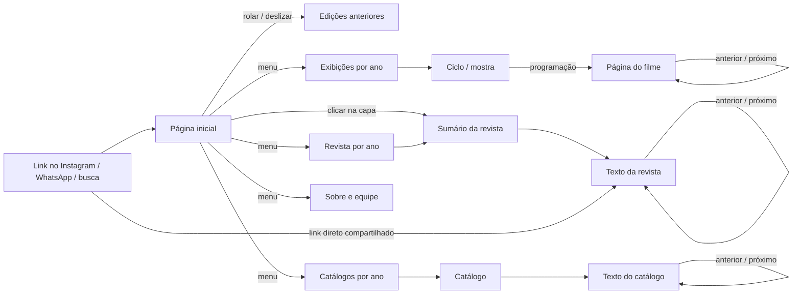
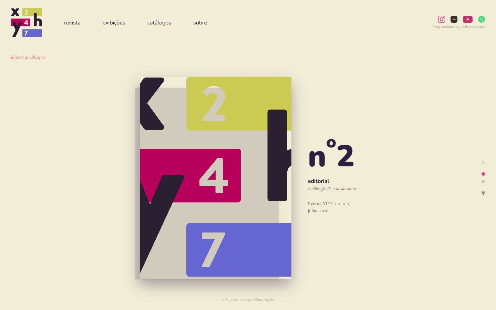
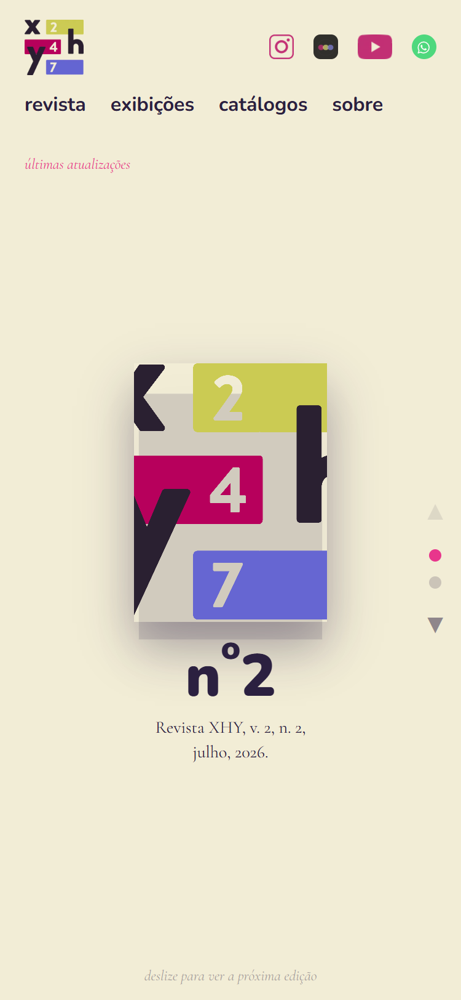
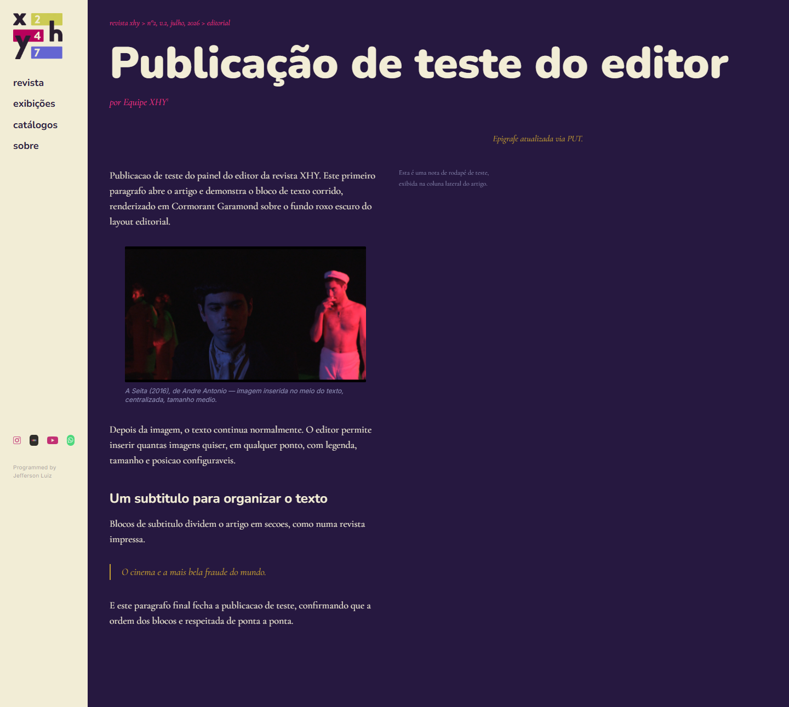
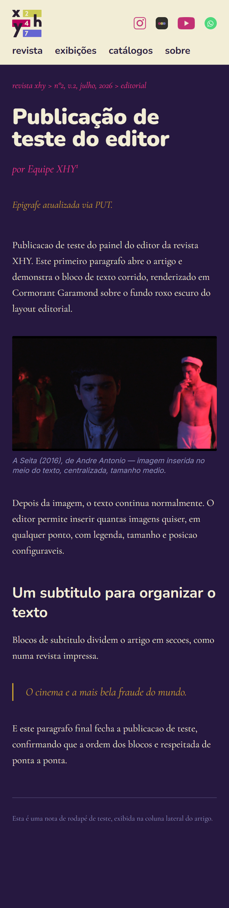

# Projeto de Interface

O projeto de interface partiu de uma referência concreta: os **catálogos impressos** do
Cineclube XHY (Júlio Bressane, David Lynch, Salomé, Sirk & Fassbinder). A diagramação
desses catálogos definiu a paleta, a tipografia, o uso do fundo escuro para leitura e o
posicionamento de notas e epígrafes. O desafio foi traduzir essa linguagem de papel para
a tela, em qualquer tamanho, sem perder o caráter editorial.

## User Flow

O site tem dois fluxos independentes: o do **público**, que lê, e o da **editoria**, que
publica.

### Fluxo do público



Um link compartilhado leva direto ao texto, com prévia (título, autor, capa) gerada pelas
metatags. De qualquer página, a navegação lateral (ou a barra superior no celular) leva às
quatro seções e à página inicial pelo logo.

### Fluxo da editoria

```mermaid
flowchart LR
    L[/admin/login] -->|senha| P[Painel: revistas]
    P --> NR[Nova edição] --> ED[Edição: dados, capa, textos]
    ED --> NA[Novo texto] --> BE[Editor de blocos]
    ED --> RA[Reordenar textos]
    BE -->|rascunho ou publicado| ED
    P --> CAT[Catálogos] --> C[Catálogo: capa, descrição, textos] --> BE
    P --> CIC[Exibições] --> X[Ciclo: dados, programação, filmes] --> FL[Página do filme]
    P --> SB[Sobre: texto e equipe]
    P -->|ver o site| SITE[Site público]
```

## Protótipo

### Protótipo de baixa fidelidade

Antes da codificação, a estrutura de cada tela foi esboçada em wireframes de baixa
fidelidade a partir dos catálogos impressos. Os esquemas abaixo reproduzem esses esboços.

**Página inicial — a "prateleira"**

```
┌──────────────────────────────────────────────────────────────┐
│ [logo]   revista   exibições   catálogos   sobre    [redes] │
├──────────────────────────────────────────────────────────────┤
│ últimas atualizações                                         │
│                                                              │
│              ┌────────────┐      nº 2                        │
│              │            │      editorial                   │
│              │   CAPA     │      · título do texto           │
│              │            │      · título do texto           │
│              │            │                                  │
│              └────────────┘      Revista XHY, v.2, n.2,  ▲●○▼│
│                                  julho, 2026.                │
│                 role para ver a próxima edição               │
└──────────────────────────────────────────────────────────────┘
```

A rolagem não move a página: troca a edição em exibição, como quem retira uma revista da
pilha. Setas, pontos e teclado também navegam.

**Páginas internas — navegação lateral (desktop)**

```
┌──────────┬───────────────────────────────────────────────────┐
│ [logo]   │ revista xhy > nº2 > editorial          (breadcrumb)│
│          │                                                   │
│ revista  │ TÍTULO DO TEXTO                                   │
│ exibições│ por Autor¹                                        │
│ catálogos│                              epígrafe à direita   │
│ sobre    │                                                   │
│          │ Parágrafo do texto em serifa,     ¹ nota lateral  │
│          │ corrido, sobre fundo roxo         em corpo menor  │
│          │ escuro.  ┌───────┐ texto continua                 │
│          │          │imagem │ ao lado da                     │
│          │          └───────┘ imagem flutuante               │
│          │                                                   │
│ [redes]  │ ▬ [próximo texto], por Autor                      │
│          │ ▬ [texto anterior], por Autor                     │
└──────────┴───────────────────────────────────────────────────┘
```

**Páginas internas — celular**

```
┌────────────────────────┐
│ [logo]          [redes]│
│ revista exibições      │
│ catálogos sobre        │
├────────────────────────┤
│ revista xhy > nº2      │
│                        │
│ TÍTULO DO              │
│ TEXTO                  │
│ por Autor¹             │
│ epígrafe               │
│                        │
│ Parágrafo corrido em   │
│ coluna única.          │
│ ┌────────────────────┐ │
│ │ imagem centralizada│ │
│ └────────────────────┘ │
│ legenda                │
│ ───────────────────    │
│ ¹ nota abaixo do texto │
└────────────────────────┘
```

No celular a coluna lateral vira barra superior, imagens deixam de flutuar e as notas
descem para depois do texto.

### Protótipo de alta fidelidade

O protótipo de alta fidelidade foi construído diretamente em código, sobre o template
padrão descrito em [Template padrão da Aplicação](05-Template%20padr%C3%A3o%20da%20Aplica%C3%A7%C3%A3o.md),
e validado com a equipe do cineclube. As telas finais estão em
[Programação de Funcionalidades](06-Programa%C3%A7%C3%A3o%20de%20Funcionalidades.md).

| Página inicial (desktop) | Página inicial (celular) |
|---|---|
|  |  |

| Texto da revista (desktop) | Texto da revista (celular) |
|---|---|
|  |  |
