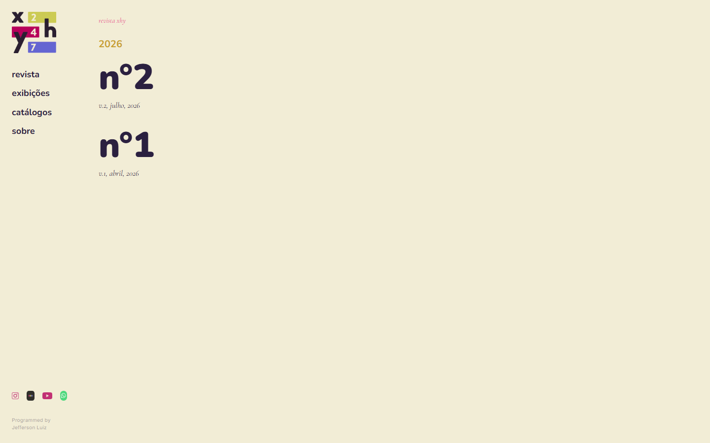
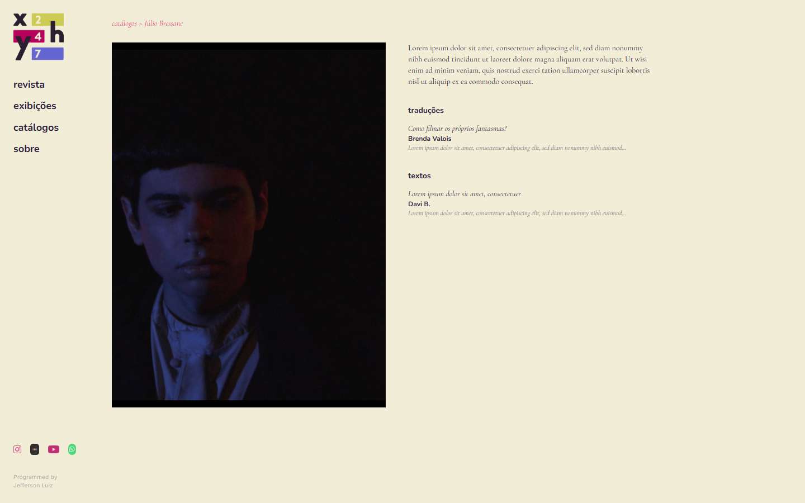
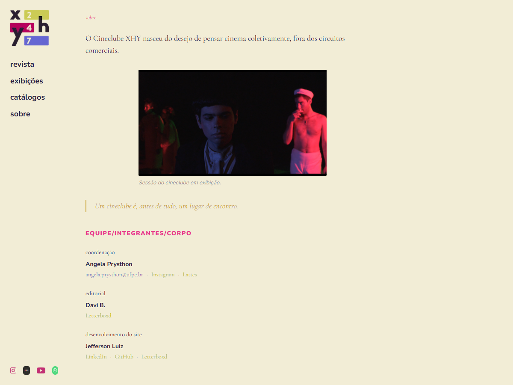
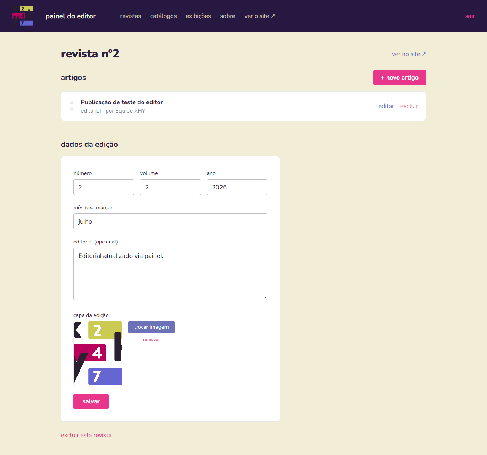
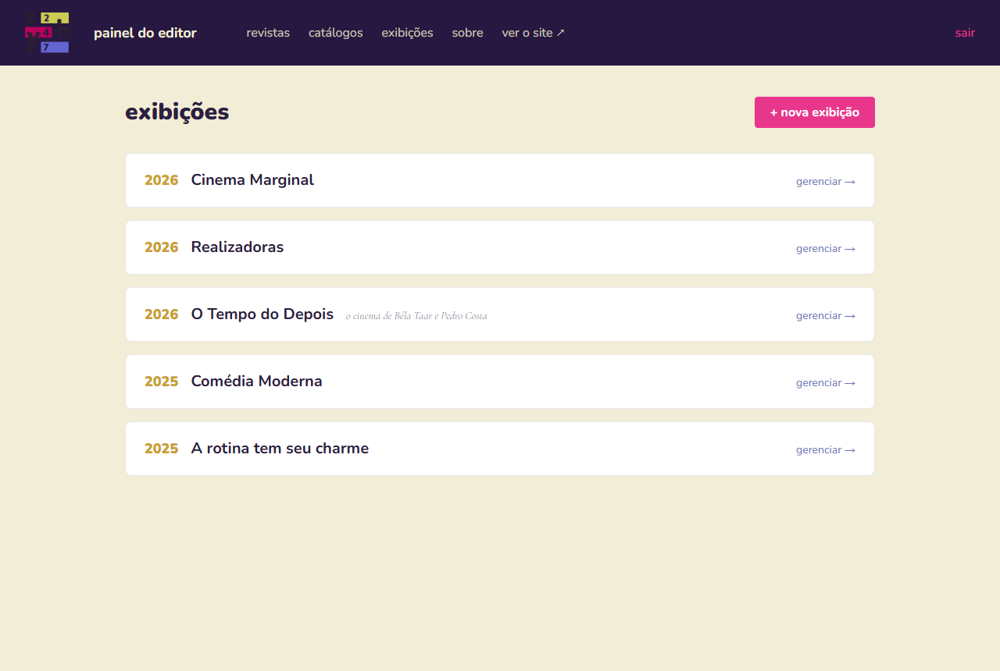
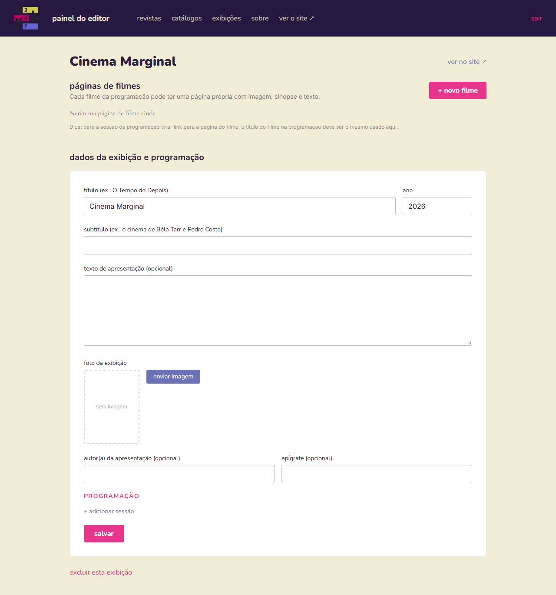

# Programação de Funcionalidades

Este documento descreve as funcionalidades implementadas, relacionando cada uma aos
requisitos da [Especificação do Projeto](02-Especifica%C3%A7%C3%A3o%20do%20Projeto.md),
aos arquivos que a implementam, à estrutura de dados envolvida e à forma de acesso.
Todas as funcionalidades foram desenvolvidas por **Jefferson Luiz Mendonça da Silva**.

## Estrutura de dados

O conteúdo é armazenado no MongoDB em seis coleções, definidas com Mongoose em
`codigo-fonte/backend/src/models/`:

| Coleção | Modelo | Campos principais |
|---|---|---|
| `magazines` | `Magazine` | `number` (único), `volume`, `month`, `year`, `coverImage`, `editorial`, `slug` |
| `articles` | `Article` | `title`, `slug` (único), `author`, `column`, `epigraph`, `blocks[]`, `content` (texto puro derivado dos blocos), `footnotes[]`, `coverImage`, `published`, `order`, `parentType` (`revista` / `catalogo` / `ciclo`), `parentId` |
| `catalogs` | `Catalog` | `title`, `slug`, `year`, `coverImage`, `description` |
| `cycles` | `Cycle` | `title`, `subtitle`, `slug`, `year`, `coverImage`, `description`, `author`, `epigraph`, `footnotes[]`, `screenings[]` (`date`, `time`, `filmTitle`, `filmSlug`, `director`, `duration`, `country`) |
| `films` | `Film` | `title`, `slug`, `director`, `year`, `duration`, `country`, `image`, `synopsis`, `content`, `author`, `footnotes[]`, `cycleId`, `order` |
| `abouts` | `About` | `blocks[]`, `content`, `team[]` (`name`, `role`, `email`, `links[]`) |

Um **bloco** de texto (`blockSchema`) tem a forma:

```ts
{
  type: 'paragraph' | 'subtitle' | 'quote' | 'image',
  text?: string,                                   // parágrafo, subtítulo, citação
  src?: string, caption?: string,                  // imagem
  align?: 'full' | 'left' | 'right' | 'center',    // imagem
  width?: 'small' | 'medium' | 'large'             // imagem
}
```

A API (`codigo-fonte/backend/src/routes/`) expõe rotas públicas de leitura
(`/api/home`, `/api/revista`, `/api/catalogos`, `/api/ciclos`, `/api/sobre`) e rotas
protegidas de escrita (`/api/auth`, `/api/upload`, `/api/admin/*`). A lista completa está
no [README do código-fonte](../codigo-fonte/README.md#api-de-publica%C3%A7%C3%A3o).

---

## Página inicial — prateleira de edições


**Requisito atendido:** RF-001.

**Artefatos:** `frontend/src/app/(listas)/page.tsx`, `components/HomeShowcase.tsx`,
`components/TopNav.tsx`; `backend/src/routes/home.ts`.

**Funcionamento:** a rota `/api/home` devolve a publicação mais recente (revista ou
catálogo, pelo `createdAt`) e todas as edições da revista com seus textos publicados. O
componente `HomeShowcase` empilha as edições; roda do mouse, gesto de deslizar, teclado,
setas e pontos alternam a edição em exibição com transição animada. A página ocupa a
altura da tela e não rola.

**Acesso:** `/`.

---

## Revista — listagem, sumário e leitura

| Listagem por ano | Sumário da edição |
|---|---|
|  |  |


**Requisitos atendidos:** RF-002, RF-003, RF-011 (só textos publicados aparecem).

**Artefatos:** `frontend/src/app/(listas)/revista/page.tsx`,
`app/revista/[number]/page.tsx`, `app/revista/[number]/artigo/[slug]/page.tsx`,
`components/ArticleBody.tsx`, `components/ArticleNav.tsx`, `components/Breadcrumb.tsx`;
`backend/src/routes/revista.ts`.

**Funcionamento:** a listagem agrupa edições por ano em ordem decrescente. O sumário
mostra capa, trecho do editorial e textos agrupados por coluna. A página do texto renderiza
os blocos com `ArticleBody`: epígrafe à direita, imagens com legenda e alinhamento, notas
na coluna lateral (desktop) ou após o texto (celular), e navegação para o texto anterior e
o seguinte. A rota antiga `/revista/[n]/[coluna]/[slug]` redireciona permanentemente
(HTTP 308) para o endereço canônico.

**Acesso:** `/revista`, `/revista/2`, `/revista/2/artigo/<slug>`.

---

## Catálogos



**Requisitos atendidos:** RF-004, RF-011.

**Artefatos:** `frontend/src/app/(listas)/catalogos/page.tsx`,
`app/catalogos/[slug]/page.tsx`, `app/catalogos/[slug]/[textSlug]/page.tsx`;
`backend/src/routes/catalogos.ts`.

**Funcionamento:** mesma lógica da revista, com textos agrupados por seção e página de
leitura em fundo escuro. Os textos de catálogo são documentos `Article` com
`parentType: 'catalogo'`.

**Acesso:** `/catalogos`, `/catalogos/<slug>`, `/catalogos/<slug>/<texto>`.

---

## Exibições — ciclos, programação e filmes


**Requisito atendido:** RF-005.

**Artefatos:** `frontend/src/app/(listas)/ciclos-mostras/page.tsx`,
`app/ciclos-mostras/[slug]/page.tsx`, `app/ciclos-mostras/[slug]/[filmSlug]/page.tsx`;
`backend/src/routes/ciclos.ts`.

**Funcionamento:** o ciclo exibe título, subtítulo, capa, apresentação, autor e a
programação de sessões. Cada sessão cujo `filmSlug` corresponde a um `Film` cadastrado vira
link para a página do filme, com ficha técnica, imagem, sinopse, texto crítico, notas e
navegação entre filmes do ciclo.

**Acesso:** `/ciclos-mostras`, `/ciclos-mostras/<slug>`, `/ciclos-mostras/<slug>/<filme>`.

---

## Sobre — apresentação e equipe



**Requisito atendido:** RF-006.

**Artefatos:** `frontend/src/app/(listas)/sobre/page.tsx`, `components/BlockContent.tsx`,
`components/Credit.tsx`; `backend/src/routes/sobre.ts`.

**Funcionamento:** o texto de apresentação é renderizado em blocos sobre fundo claro. A
equipe é agrupada por função, com e-mail e links externos por integrante. O desenvolvedor
do site aparece como último grupo, na mesma diagramação.

**Acesso:** `/sobre`.

---

## Painel do editor — autenticação


**Requisito atendido:** RF-007; RNF-003.

**Artefatos:** `frontend/src/app/admin/login/page.tsx`, `app/admin/layout.tsx`,
`lib/adminApi.ts`; `backend/src/routes/auth.ts`, `middleware/auth.ts`.

**Funcionamento:** o editor informa a senha única (`ADMIN_PASSWORD`). A API compara em
tempo constante e devolve um token JWT válido por 7 dias, guardado no `localStorage`. Toda
rota `/api/admin/*` e `/api/upload` exige o cabeçalho `Authorization: Bearer <token>`. O
login aceita no máximo 10 tentativas por IP a cada 15 minutos; a partir daí responde 429.
Quando um token expira, o painel redireciona para o login.

**Acesso:** `/admin/login`.

---

## Painel do editor — revistas e textos

| Lista de edições | Edição: dados, capa e textos |
|---|---|
|  |  |

**Requisitos atendidos:** RF-008, RF-011, RF-012.

**Artefatos:** `frontend/src/app/admin/page.tsx`, `app/admin/revistas/nova/page.tsx`,
`app/admin/revistas/[id]/page.tsx`, `app/admin/revistas/[id]/artigos/novo/page.tsx`,
`components/admin/MagazineForm.tsx`; `backend/src/routes/admin.ts`.

**Funcionamento:** CRUD de edições (número único, volume, mês, ano, capa, editorial). Na
página da edição o editor cria textos, alterna entre rascunho e publicado, reordena por
arrastar (`PUT /api/admin/artigos/reorder`) e exclui. Excluir uma edição remove seus textos.

**Acesso:** `/admin` → edição → textos.

---

## Painel do editor — editor de blocos e upload de imagens


**Requisitos atendidos:** RF-009, RF-010; RNF-006.

**Artefatos:** `frontend/src/components/admin/ArticleEditor.tsx`,
`components/admin/BlocksEditor.tsx`, `components/admin/ImageUploadField.tsx`;
`backend/src/routes/upload.ts`.

**Funcionamento:** o texto é composto por blocos de parágrafo, subtítulo, citação e
imagem, reordenáveis por arrastar (punho ⠿) ou setas. Blocos de imagem aceitam legenda,
largura (pequena, média, grande) e alinhamento (total, centro, esquerda, direita). O upload
aceita jpg, png, webp, gif, avif e svg até 10 MB; com `CLOUDINARY_URL` configurada a
imagem vai para o Cloudinary e a URL devolvida é absoluta; sem ela, fica em
`backend/uploads/`. Ao salvar, a API gera `content` (texto puro) a partir dos blocos para
trechos e buscas.

**Acesso:** `/admin/artigos/<id>` (também usado por textos de catálogo).

---

## Painel do editor — catálogos, exibições e filmes

| Lista de ciclos | Ciclo: dados, programação e filmes |
|---|---|
|  |  |

**Requisitos atendidos:** RF-008, RF-012.

**Artefatos:** `frontend/src/app/admin/catalogos/**`, `app/admin/ciclos/**`,
`app/admin/filmes/[id]/page.tsx`, `components/admin/CatalogForm.tsx`,
`components/admin/CycleForm.tsx`, `components/admin/FilmForm.tsx`;
`backend/src/routes/admin.ts`.

**Funcionamento:** catálogos têm capa, descrição e textos por seção (mesmo editor de
blocos). Ciclos têm dados, epígrafe, notas, programação de sessões editável linha a linha e
páginas de filmes reordenáveis. Excluir um ciclo remove seus filmes e textos.

**Acesso:** `/admin/catalogos`, `/admin/ciclos`.

---

## Painel do editor — sobre

**Requisitos atendidos:** RF-006, RF-008.

**Artefatos:** `frontend/src/app/admin/sobre/page.tsx`, `components/admin/AboutForm.tsx`;
`backend/src/routes/admin.ts` (`/api/admin/sobre`).

**Funcionamento:** edição do texto de apresentação em blocos e da equipe (nome, função,
e-mail, links). O documento `About` é único e criado na primeira gravação.

**Acesso:** `/admin/sobre`.

---

## Compartilhamento, indexação e erros


**Requisitos atendidos:** RF-013, RF-014, RF-015.

**Artefatos:** `frontend/src/app/layout.tsx` (metadata padrão, fontes, `maxDuration`),
`lib/seo.ts`, `generateMetadata` em cada página de detalhe, `app/robots.ts`,
`app/sitemap.ts`, `app/not-found.tsx`, `app/error.tsx`, `app/(listas)/loading.tsx`,
`app/icon.png`.

**Funcionamento:** cada página de detalhe gera título, descrição, URL canônica e imagem
Open Graph a partir do conteúdo (capa da edição, do catálogo, do ciclo ou do filme). O
`sitemap.xml` lista páginas fixas e todas as edições, catálogos e ciclos; o `robots.txt`
bloqueia `/admin`. Páginas de listagem exibem um esqueleto de carregamento enquanto a API
responde; páginas de detalhe ficam fora desse grupo para que conteúdo inexistente responda
com HTTP 404 real, e não 200.

**Acesso:** qualquer URL pública; `/robots.txt`; `/sitemap.xml`.

---

## Responsividade

| Celular (375 px) | Desktop |
|---|---|
|  |  |

**Requisito atendido:** RNF-001.

**Artefatos:** `frontend/src/components/PageShell.tsx`, `components/Sidebar.tsx`,
`components/TopNav.tsx`, `components/HomeShowcase.tsx`, `components/ArticleBody.tsx`,
`app/globals.css`, `tailwind.config.ts`.

**Funcionamento:** descrito em [Template padrão da Aplicação](05-Template%20padr%C3%A3o%20da%20Aplica%C3%A7%C3%A3o.md#responsividade).
