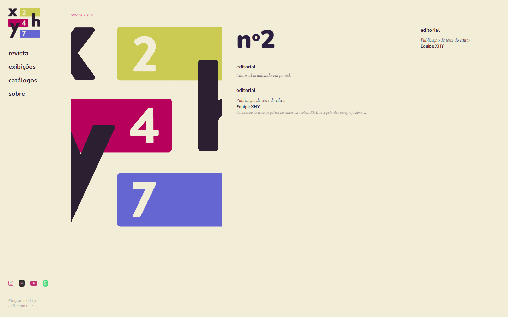
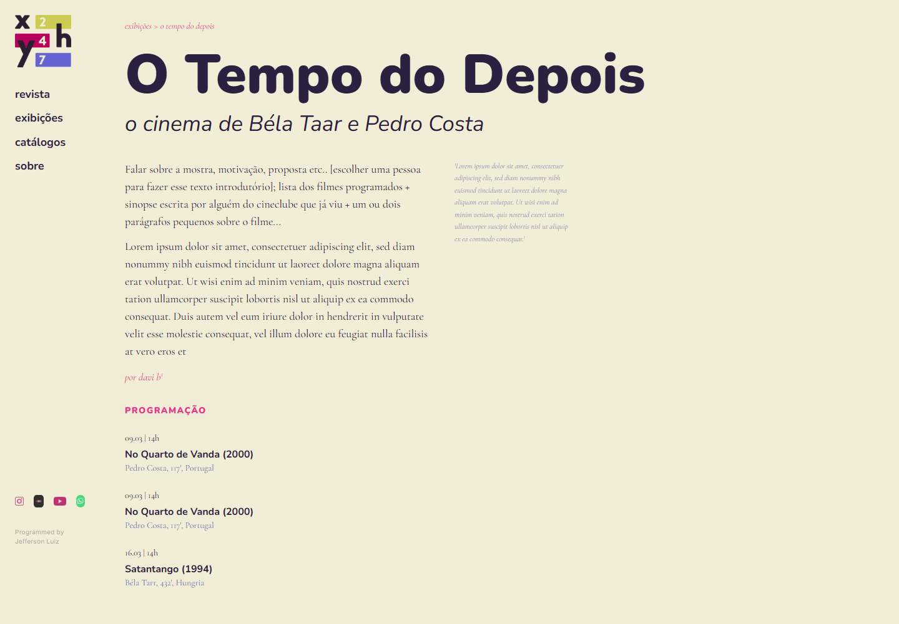
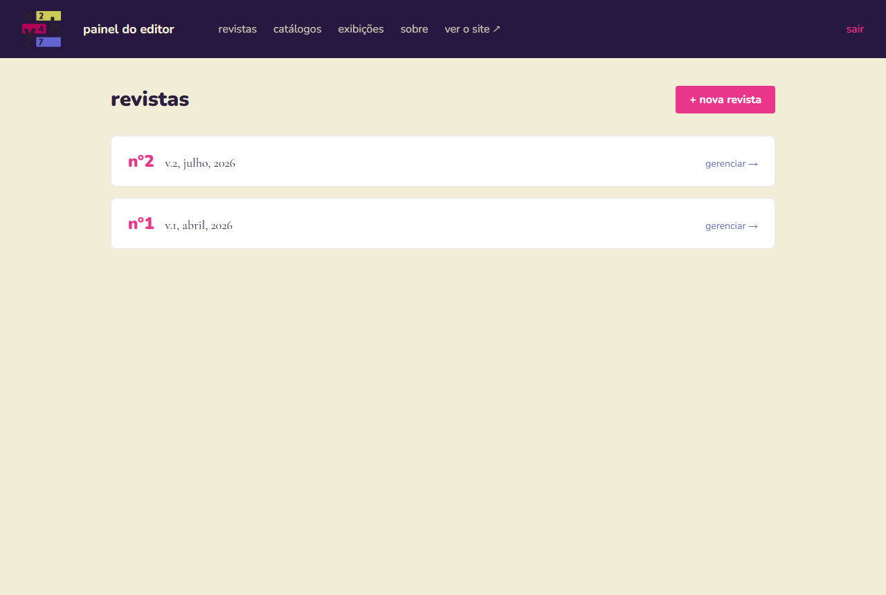
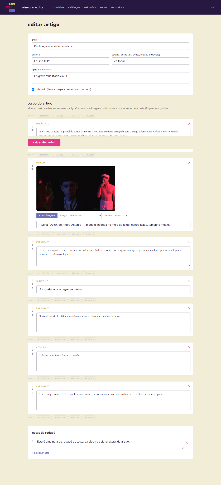

# Registro de Testes de Software

Relatório de execução do [Plano de Testes](07-Plano%20de%20Testes%20de%20Software.md).
Todos os casos foram executados por **Jefferson Luiz Mendonça da Silva** em
**15/09/2026**, na versão 1.2.0, com a API em `http://localhost:3001` conectada ao MongoDB
Atlas e o site em `http://localhost:3000` rodando o build de produção (`next build` +
`next start`).

## Resumo

| Caso | Título | Resultado |
|---|---|---|
| CT-01 | Páginas de listagem respondem | ✅ Aprovado |
| CT-02 | Páginas de detalhe respondem | ✅ Aprovado |
| CT-03 | Conteúdo inexistente devolve 404 real | ✅ Aprovado (após correção) |
| CT-04 | Login do editor | ✅ Aprovado |
| CT-05 | Rotas administrativas exigem token | ✅ Aprovado |
| CT-06 | Upload de imagens | ✅ Aprovado |
| CT-07 | Rascunho não aparece no site | ✅ Aprovado |
| CT-08 | Limite de tentativas de login | ✅ Aprovado |
| CT-09 | Metatags de compartilhamento | ✅ Aprovado |
| CT-10 | robots.txt e sitemap.xml | ✅ Aprovado |
| CT-11 | Redirecionamento da rota antiga | ✅ Aprovado |
| CT-12 | Responsividade sem rolagem horizontal | ✅ Aprovado (após correção) |
| CT-13 | Compilação sem erros | ✅ Aprovado |

## Detalhamento

| Caso de Teste | **CT-01 — Páginas de listagem respondem** |
|:---|:---|
| Resultados obtidos | `/` 200 · `/revista` 200 · `/catalogos` 200 · `/ciclos-mostras` 200 · `/sobre` 200 |
| Evidência |  |

| Caso de Teste | **CT-02 — Páginas de detalhe respondem** |
|:---|:---|
| Resultados obtidos | `/revista/2` 200 · `/revista/2/artigo/publicacao-de-teste-do-editor` 200 · `/catalogos/julio-bressane` 200 · `/ciclos-mostras/o-tempo-do-depois` 200 |
| Evidência |   |

| Caso de Teste | **CT-03 — Conteúdo inexistente devolve 404 real** |
|:---|:---|
| Resultados obtidos | **1ª execução (reprovado):** `/revista/99/artigo/nao-existe` respondeu HTTP **200** com a página 404 e `<meta name="robots" content="noindex">`. Causa: um `loading.tsx` na raiz fazia o Next.js transmitir a página em streaming, enviando o status antes de `notFound()` ser chamado. **Correção:** páginas de listagem movidas para o grupo de rotas `(listas)`, único que possui `loading.tsx`; páginas de detalhe ficaram fora dele. **2ª execução (aprovado):** artigo inexistente **404** · catálogo inexistente **404** · rota aleatória **404** · API `/api/revista/99/artigo/x` **404**. |
| Evidência |  |

| Caso de Teste | **CT-04 — Login do editor** |
|:---|:---|
| Resultados obtidos | Senha errada: `{"error":"Senha incorreta"}` HTTP **401**. Senha correta: HTTP **200** com `token` recebido. |
| Evidência |  |

| Caso de Teste | **CT-05 — Rotas administrativas exigem token** |
|:---|:---|
| Resultados obtidos | Sem token: **401** · token inválido (`Bearer abc`): **401** · token válido: **200** com a lista de edições. |
| Evidência |  |

| Caso de Teste | **CT-06 — Upload de imagens** |
|:---|:---|
| Resultados obtidos | Sem token: **401**. Arquivo de texto (`text/plain`) com token: **400** `{"error":"Apenas imagens são permitidas (jpg, png, webp, gif, avif, svg)"}`. PNG com token: **200** `{"url":"/uploads/1789524600007-logo-xhy.png"}` (ambiente local, sem Cloudinary). |
| Evidência |  |

| Caso de Teste | **CT-07 — Rascunho não aparece no site** |
|:---|:---|
| Resultados obtidos | Criado texto `rascunho-de-teste-ct-08` com `"published":false` na edição nº 2. **Rascunho:** no admin 1 ocorrência · no sumário público 0 · página pública **404**. **Após `PUT {"published":true}` (200):** no sumário público 1 · página pública **200**. **Após `DELETE` (200):** página pública **404**. |

| Caso de Teste | **CT-08 — Limite de tentativas de login** |
|:---|:---|
| Resultados obtidos | 11 requisições com senha errada: `401 401 401 401 401 401 401 401 401 401 429`. A 11ª devolveu `{"error":"Muitas tentativas de login. Aguarde alguns minutos e tente novamente."}`. Observação: o bloqueio afetou o próprio ambiente de teste por 15 minutos, confirmando que vale também para o cliente legítimo do mesmo IP; a API foi reiniciada para prosseguir. |

| Caso de Teste | **CT-09 — Metatags de compartilhamento** |
|:---|:---|
| Resultados obtidos | `<title>Publicação de teste do editor \| Cineclube XHY</title>`. Seis metatags Open Graph presentes: `og:title`, `og:description`, `og:url`, `og:type`, `og:image`, `og:image:alt`. |

| Caso de Teste | **CT-10 — robots.txt e sitemap.xml** |
|:---|:---|
| Resultados obtidos | `/robots.txt` **200** com `Disallow: /admin` · `/sitemap.xml` **200** com **17 URLs** (5 fixas + edições, catálogos e ciclos cadastrados). |

| Caso de Teste | **CT-11 — Redirecionamento da rota antiga** |
|:---|:---|
| Resultados obtidos | `/revista/2/editorial/publicacao-de-teste-do-editor` → HTTP **308**, `Location: /revista/2/artigo/publicacao-de-teste-do-editor`. |

| Caso de Teste | **CT-12 — Responsividade sem rolagem horizontal** |
|:---|:---|
| Resultados obtidos | **1ª execução (reprovado):** três medições com `scrollWidth > clientWidth` na página inicial (1971 px) e no catálogo em tablet (1928 px), causadas pela imagem da capa medida antes da folha de estilo aplicar a largura do contêiner. **2ª execução (aprovado):** 30 combinações (10 páginas × 3 viewports) com `scrollWidth == clientWidth`; saída do script: "Sem overflow horizontal em nenhuma página". Inspeção visual das capturas sem cortes. Ajuste adicional: menu da página inicial passou a ocupar linha própria no celular. |
| Evidência |   |

| Caso de Teste | **CT-13 — Compilação sem erros** |
|:---|:---|
| Resultados obtidos | Backend: `tsc --noEmit` código 0. Frontend: `next build` → "✓ Compiled successfully", "✓ Generating static pages (20/20)", 33 rotas listadas, JavaScript inicial das páginas públicas entre 87 kB e 101 kB. |

## Defeitos encontrados e corrigidos durante os testes

| # | Defeito | Correção |
|---|---|---|
| 1 | Links dos textos de catálogo apontavam para `/catalogos/<slug>/texto/<texto>`, rota inexistente (404). | Links e navegação anterior/seguinte passaram a usar `/catalogos/<slug>/<texto>`. |
| 2 | Páginas de conteúdo inexistente respondiam 200 (CT-03). | Grupo de rotas `(listas)` isolando o `loading.tsx`. |
| 3 | Menu da página inicial empilhava em coluna ao lado do logo no celular. | `TopNav` com o menu em linha própria abaixo de 640 px. |

## Registro da versão 1.3.0 (outubro/2026)

Execução por **Jefferson Luiz Mendonça da Silva**, com testes automatizados (os mesmos que
o CI roda) e verificação no navegador.

| Caso | Título | Resultado |
|---|---|---|
| CT-14 | Suíte da API (rotas e regras) | ✅ Aprovado: 112 testes passando (`npm test` no backend, 13/10/2026) |
| CT-15 | Segurança da API | ✅ Aprovado (incluído nos 112) |
| CT-16 | Modo demonstração | ✅ Aprovado (incluído nos 112) |
| CT-17 | Regras do front | ✅ Aprovado: 19 testes passando (`npm test` no frontend) |
| CT-18 | Lint, formatação e build | ✅ Aprovado: ESLint sem avisos nos dois projetos, Prettier sem diferenças, `next build` concluído sem a API no ar |
| CT-19 | Status HTTP honestos | ✅ Aprovado: `/revista/999` e `/revista/1/artigo/nada` respondem 404; com a API fora, páginas em cache continuam com conteúdo (H11) |
| CT-20 | Fluxo do editor | ✅ Aprovado: senha errada anunciada; sessão invalidada no meio de uma edição abriu o re-login por cima da página com o campo editado preservado; depois de entrar, salvar funcionou e mostrou o aviso de sucesso; diálogo de exclusão mostrou "3 textos" e exigiu digitar o nome |
| CT-21 | Carga antes/depois | ✅ Executado: H1 a H9 e H11 confirmadas, H5 refutada para melhor, H10 parcial (detalhes em `docs/carga/2026-10-04-resultados.md`) |

### Defeitos encontrados e corrigidos na 1.3.0

| # | Defeito | Correção |
|---|---|---|
| 4 | API fora do ar aparecia como lista vazia nas listagens e como 404 nas páginas de detalhe. | `ErroApi` separado de `ErroNaoEncontrado`; "serviço indisponível" no `error.tsx`; cache de 60 s. |
| 5 | Sessão expirada mandava para o login e perdia o que estava sendo editado. | Re-login por cima da página e rascunho local. |
| 6 | Criação simultânea com o mesmo título gerava 500 (E11000). | Slug calculado numa consulta e nova tentativa em colisão. |
| 7 | Nota do autor e notas do ciclo nunca apareciam no site. | Componente `Notas` com âncoras. |
| 8 | Reordenar ou excluir no painel falhava em silêncio. | Tratamento de erro, volta da ordem e avisos. |
| 9 | `loading.tsx` nas páginas de detalhe voltaria a responder 200 para conteúdo inexistente. | `loading.tsx` só onde não há 404 (busca e autores). |
| 10 | Falha ao gravar uma imagem em disco derrubava o processo da API. | `try/catch` e resposta 500. |
